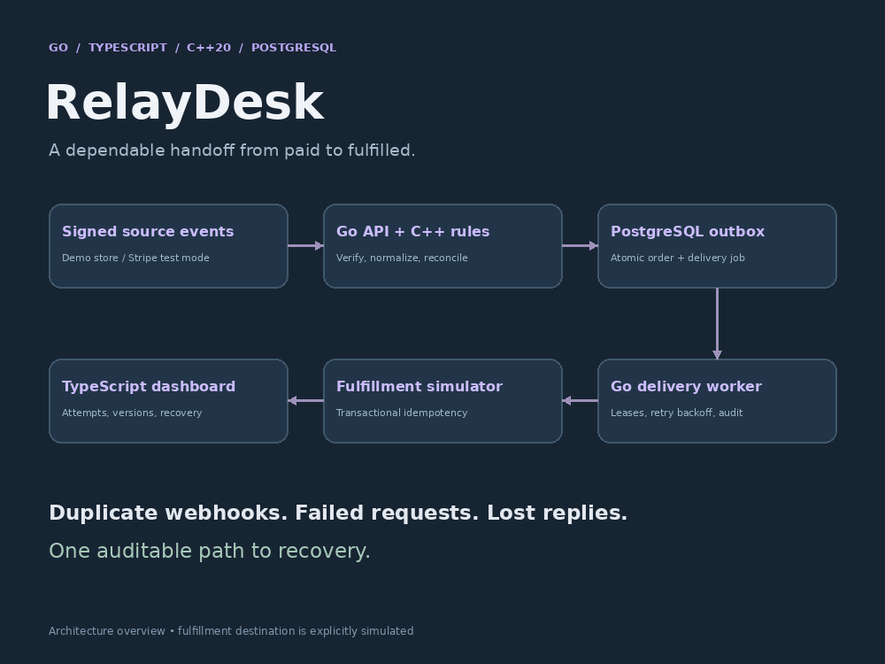
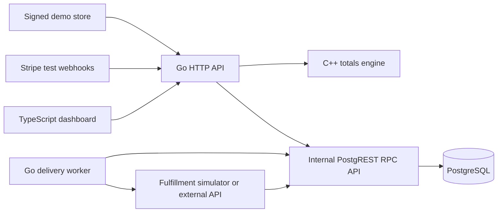

# RelayDesk — Order synchronization service



[Detailed architecture](docs/architecture.svg)

A Go backend and background worker, a TypeScript operations dashboard, and a C++ monetary-validation engine. PostgreSQL provides durable state, served internally through PostgREST. The demo connects a signed synthetic store to a persistent fulfillment simulator and deliberately exercises failures.

The business problem: orders should reach a second system even when webhooks repeat, requests fail, responses get lost, or events arrive out of order. Operators need an explanation of what happened and a way to recover failures.

## Start

Requires Docker Engine and Compose v2 with daemon access. No host Go/C++/Node installation is needed for the Docker workflow. First build downloads images and the TypeScript compiler.

```bash
cd order-sync
cp .env.example .env
docker compose up --build -d
```

Open **http://127.0.0.1:8090** and sign in with the workspace token in `.env`.

Default local token: `relaydesk-local-admin`.

```bash
docker compose ps
docker compose logs -f --tail=100 api worker destination
# Stop, preserving saved data:
docker compose down
```

Port 8090 avoids the earlier portfolio apps. Only the Go API publishes a port, bound to localhost. PostgreSQL, PostgREST, and the fulfillment simulator stay on the Compose network.

## What to demonstrate

### Duplicate webhook

1. Keep Destination set to Healthy and send a sample order.
2. Click Replay last webhook several times.
3. Inspect the order: the duplicate counter increases, but only one version/delivery exists.

The event's ID is durable across API/worker restarts. A reused event ID with conflicting content is rejected instead of silently overwriting the first event. JSON whitespace and object key order do not change its fingerprint; signature verification still uses exact raw wire bytes.

### Destination outage

1. Switch the simulator to 503 outage and send another order.
2. Open its inspector to see retries and timestamps.
3. Restore Healthy. The next scheduled retry recovers the delivery.
4. If five attempts have already failed, choose Retry in the inspector or Delivery log.

Manual retry begins a new five-attempt cycle while retaining the lifetime attempt count and existing history.

### Lost acknowledgement after commit

1. Select Commit, then lose first reply.
2. Send a new order.
3. The destination commits the order, then returns one simulated 503.
4. The worker retries using the same Idempotency-Key. The destination returns the existing receipt instead of writing again.

This is a deliberately simulated ambiguous outcome, not a claim that a real connection was physically interrupted. The SQL test and live smoke test verify the single destination commit.

### Newer versions win

Use Update last order to change its quantity and source version. Each version gets an immutable delivery payload. The simulator rejects a conflicting equal version and acknowledges an older version without downgrading the current order. Older failed deliveries remain visible even when a newer version has been delivered.

The simulator controls affect all simulator traffic in this workspace; use a dedicated test stack when proving behavior. If DESTINATION_URL points to an external API, these controls do not inject failures into that external service.

## Architecture



- **Go:** JSON normalization, HMAC authentication, bounded requests, session protection, HTTP administration, durable turn/lease RPC calls, exponential retry scheduling, graceful shutdown, and delivery to the second system.
- **C++20:** checked integer arithmetic for item subtotals, quantities, shipping, tax, discounts, and declared totals. The input protocol is a small numeric stream; no shell or third-party JSON parser is involved. Its role is monetary validation, not a claimed performance advantage over Go.
- **TypeScript:** typed API responses, responsive dashboard, search/filter/pagination, delivery inspector, manual retries, simulator controls, activity, and connection instructions. Compiled JS/CSS/HTML are embedded in the Go binary.
- **PostgreSQL/PL/pgSQL:** atomic event deduplication + order updates + outbox insertion, claim/lease fencing, retry transitions, destination idempotency receipts, version guards, and audit records.
- **PostgREST:** exposes only the `api` RPC schema on the internal network. Application tables are in an unexposed `internal` schema. The app role cannot directly write tables.

A database queue keeps the order change and its scheduled delivery in the same transaction; there is no second queue broker to synchronize. A second worker can claim jobs using row locks and SKIP LOCKED. No Redis dependency is required.

### Delivery guarantees

Delivery is **at least once**. A destination write can be effectively once **only when the receiver implements transactional idempotency**. The included simulator does. An arbitrary third-party API without that contract may still duplicate work after an ambiguous response. This project does not claim exactly-once network transport.

- Per-source event IDs are unique; order identity is `(source, external_id)`.
- Each increasing source version creates one delivery, keyed by a delivery UUID.
- Every retry, including a manual retry, keeps that same delivery UUID as Idempotency-Key.
- The queue lease lasts 30 seconds; an outbound request times out after 8 seconds.
- Completion must present the current unexpired lease token. Stale workers cannot advance state.
- Network errors, 408, 425, 429, and 5xx retry. Other non-2xx responses fail for operator review.
- Backoff starts near 2 seconds, doubles, and caps near 60 seconds with jitter. Retry-After is honored up to 300 seconds.
- Five attempts exhaust a retry cycle. A crashed final attempt is eventually dead-lettered rather than left processing forever.
- Claimed-but-crashed attempts count against the budget and appear as lease/audit events; only completed requests have a completed-attempt record.
- Destination versions prevent a delayed old delivery from replacing newer data.

## Real Stripe test adapter

The built-in demo is simulated; the Stripe endpoint accepts actual **test-mode snapshot events**. It does not call Stripe's APIs and needs no API key.

1. Run the local stack.
2. In a terminal where the Stripe CLI is installed and authenticated:

```bash
stripe listen \
  --events checkout.session.completed,checkout.session.async_payment_succeeded \
  --forward-to localhost:8090/webhooks/stripe
```

3. Copy the listener's `whsec_...` signing secret into `STRIPE_WEBHOOK_SECRET` in `.env`, then apply it:

```bash
docker compose up -d --force-recreate api
stripe trigger checkout.session.completed
```

The adapter verifies the timestamped HMAC-SHA256 signature over the raw body, accepts any matching `v1` signature for secret-rotation compatibility, and enforces a five-minute freshness window. It rejects live-mode events. Unrelated events and unpaid sessions are acknowledged as ignored.

Paid session notifications normalize to the session ID and paid-state version 1, so two equivalent paid notifications do not generate two deliveries. This MVP does not synchronize refunds, cancellations, customer edits, or Checkout line-item details. A changed paid snapshot for the same version produces a visible conflict rather than silently replacing data.

Stripe snapshot totals are checked against numeric bounds, but item-level arithmetic cannot be reconciled when the event has no line-item list. The inspector explicitly reports that limitation. Demo orders include full item details and receive full C++ reconciliation.

A Stripe CLI login/test-account session was not available during implementation. See VALIDATION.md for the checks actually executed.

## Send signed events from a CLI

Requires Node 20+ on the host:

```bash
node scripts/send-event.mjs
# Reuse the saved event ID to demonstrate deduplication:
node scripts/send-event.mjs sample-event.json
```

Set `APP_URL` and `DEMO_WEBHOOK_SECRET` in that shell if you changed the defaults. The script signs each request with a fresh timestamp but preserves the saved event body. The generated JSON uses fictional customer data.

Normalized/demo item amounts, shipping, tax, and discounts are **integer currency minor units**. Floating-point money is rejected. The supported monetary ceiling is 1,000,000,000,000 minor units; each quantity is 1–10,000 and at most 500 lines are accepted. The C++ validator checks multiplication and addition before arithmetic can exceed that ceiling.

## API

The dashboard uses a signed HttpOnly, SameSite=Strict session cookie, plus same-origin and custom-header protection for writes. Scripts may use `Authorization: Bearer ADMIN_TOKEN` instead.

| Method | Route | Purpose |
| --- | --- | --- |
| POST | `/api/login` | Exchange workspace token for a 12-hour session |
| POST | `/api/logout` | Clear session |
| GET | `/api/overview` | Counts, simulator mode, worker heartbeat |
| GET | `/api/orders?search=&status=&offset=0` | 25-order page |
| GET | `/api/orders/{uuid}` | Versions, attempts, audit, destination record |
| GET | `/api/deliveries` | Most recent 100 delivery versions |
| GET | `/api/activity` | Most recent 100 audit entries |
| POST | `/api/deliveries/{uuid}/retry` | Retry a failed delivery |
| POST | `/api/demo` | `{ "action": "new" / "replay" / "update" }` |
| POST | `/api/simulator` | `{ "mode": "healthy" / "outage" / "lost_ack" }` |
| POST | `/webhooks/demo` | Timestamped Relay-Signature header + demo JSON |
| POST | `/webhooks/stripe` | Stripe-Signature header + test snapshot JSON |
| GET | `/healthz` | Process liveness |
| GET | `/readyz` | Database API readiness |

The simulator's private `POST /orders` requires the destination bearer credential and a UUID Idempotency-Key. It stores the idempotency receipt in the same PostgreSQL transaction as the business write.

An external destination URL is server-configured, not supplied by webhook senders. Redirects are not followed, so the worker does not forward credentials to redirect targets. Response bodies and customer data are not emitted in application error logs.

## Tests

The Docker build compiles all three languages, runs TypeScript tests, runs the C++ checks, and runs Go vet and race-enabled Go tests (including the Go/C++ process contract):

```bash
docker compose build api
```

A live PostgreSQL transaction test should run with the worker stopped. It rolls back its changes. Use a development stack:

```bash
docker compose stop worker
docker compose exec -T db psql -U postgres -d relaydesk -v ON_ERROR_STOP=1 < tests/database.sql
docker compose up -d worker
```

A real HTTP/database/worker/C++ smoke test sends eight concurrent replays and proves duplicates, lost replies, version updates, five-attempt failure, and manual recovery:

```bash
docker compose exec -T api relaydesk -mode smoke
```

The smoke test changes simulator mode and creates synthetic records. Run it in an otherwise idle development workspace; it restores Healthy on exit. It usually takes about a minute because it waits through actual retry backoff, but no timing has been measured in the build environment.

GitHub Actions configuration is supplied for the full container build, PostgreSQL transaction test, and live smoke. [GitHub Actions run 44299083434](https://github.com/TechiLoki/relaydesk/actions/runs/44299083434) passed the complete build, PostgreSQL transaction checks, and real HTTP recovery proof. See VALIDATION.md for the exact tested commit and remaining limits.

For host development with Go 1.24+, C++20, Node 20+, and TypeScript:

```bash
cd web
npm ci
npm run build
npm test
cd ..
sh scripts/check-local.sh
```

Generated browser assets are committed so `go test` can resolve the embed directive. `scripts/check-local.sh` explicitly reports when native/backend checks cannot run.

## Local deployment scope

This is a single-user local portfolio application, not a hosted multi-tenant product. Keep the localhost binding and replace development secrets before any exposure. Remote deployment also needs TLS, a proper identity/access model, request limits, and a deliberate policy for simulator controls and customer-data retention.

PostgreSQL schema files run only on first initialization of the named volume. Do not delete the volume to deploy code changes. Later database changes need explicit migrations. For development credentials, use URL-safe database passwords because the PostgREST connection URI uses them directly; changing `.env` does not rotate an existing database role's password.

Backup example:

```bash
docker compose exec -T db pg_dump -U postgres -d relaydesk > relaydesk-backup.sql
```

No data deletion/reset control is provided in the UI. Backups should be restore-tested in a separate stack before relying on them.

## Portfolio description

“Built an order synchronization service with a Go API and delivery worker, a C++ checked-arithmetic validation engine, a TypeScript operations dashboard, and PostgreSQL transactions exposed through internal PostgREST RPCs. Implemented signed webhook ingestion, durable deduplication, version-aware delivery, lease fencing, retries with backoff, manual recovery, and an auditable fulfillment simulator.”

Describe the Stripe integration as test-mode capable, not live-account verified, until you have exercised it against your own Stripe test account.

## References

- [Stripe webhook handling, raw-body verification, duplicates, and local testing](https://docs.stripe.com/webhooks)
- [PostgreSQL queue locking and SKIP LOCKED](https://www.postgresql.org/docs/16/sql-select.html)
- [PostgREST function RPCs](https://docs.postgrest.org/en/v12/references/api/functions.html)
